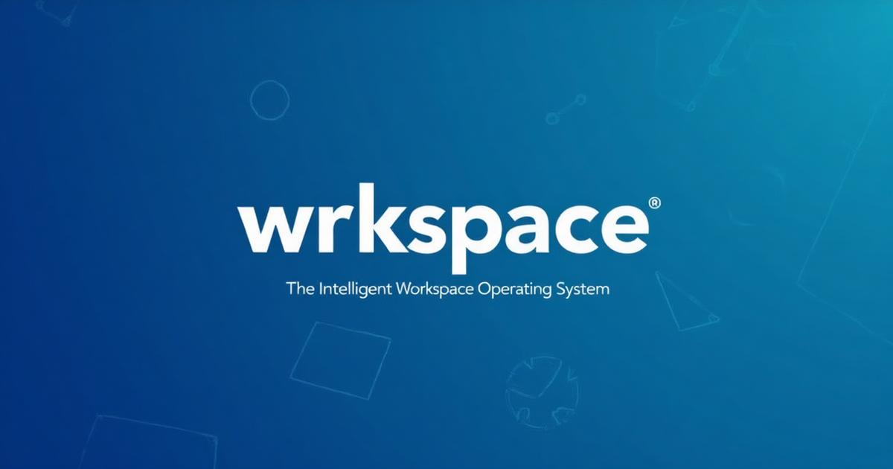

### Project Deliverables

::: {layout-ncol=2}

::: {.card .text-center .p-3}

[**Presentation Slides**](WRKSPACE%20Slide%20Deck.pdf)
:::

::: {.card .text-center .p-3}

[**Live Demo Website**](https://wrkspace.app/demo-day)
:::

:::